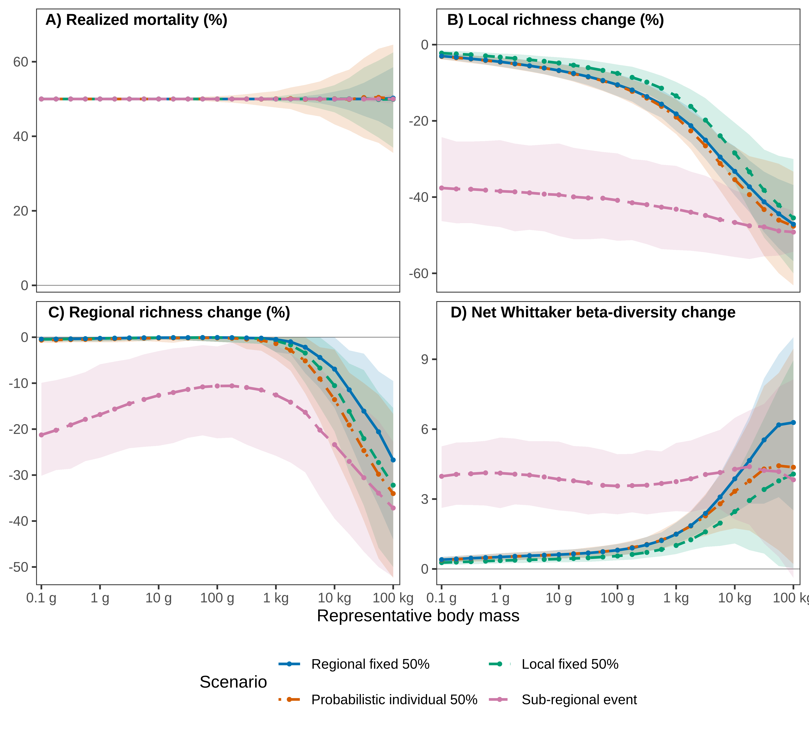

# What would happen to animal diversity if 50% of individuals disappeared?
By Angel Rain-Franco & Jakob Pernthaler

Inspired by the fictional *Thanos snap* in the Marvel universe, the project **Thanos Snap** uses spatial simulations to explore how different distributions of individual-level mortality influence species diversity across animal body sizes. 

## Design and implementation
Analysis  used **R 4.4.3** and packages including *mobsim*, *ecopart*, *spatstat*, *vegan*, *dplyr*, *tidyr*, and *ggplot2*. Package versions and implementation is documented alongside the script. Given the computationally intensive nature of the simulations, the implementation uses the *paralel* package multi-core calculation using high-performance computing cluster. 

### Environment installation
Most dependencies are managed via Conda, you can the `thanos_environment.yml` file available here.

1. **Create and activate the Conda environment:**

```
conda env create -f thanos_environment.yml
conda activate thanos-r
```

2. **Install additional R packages:**

Some packages are not included in the Conda environment and must be installed separately.
Install *mobsim* and the required *spatstat* from CRAN:

```
Rscript -e 'install.packages(c("mobsim", "spatstat.geom", "spatstat.random"), repos="https://cloud.r-project.org")'
```

Install *ecopart* from its GitHub repository:

```
Rscript -e 'remotes::install_github("communityecologist/ecopart", upgrade="never")'
```

### Spatial simulation
Individual spatial distributions were generated using a Thomas cluster process implemented with mobsim (May et al., 2018), using two cluster centres ("mother points") per species and a bivariate Gaussian distribution. Spatial aggregation was controlled by the dispersal parameter (σ). To assess the effects of mortality on communities across body sizes, we generated a gradient of expected species abundances following the body size–abundance scaling relationship described by the Damuth's law  (Damuth, 1981).


### Disturbances (mortality scenarios)
The simulations compare four scenarios with a nominal **50% mortality** disturbance:
1. **Regional fixed 50%:** half of individuals are removed at the regional scale.
2. **Local fixed 50%:** half of individuals are removed within local sampling units.
3. **Probabilistic individual 50%:** each individual has a 50% mortality probability.
4. **Sub-regional event:** mortality is concentrated unevenly across space.

The supplied run summary reports **25 body-size classes (0.1 g to 100 kg)**, **1,000 iterations**, and **30 non-overlapping, occupied sampling quadrats per iteration**. Initial ecological and simulation parameters are documented in **Supplementary Table S2** of the associated study.

### Examples
These examples illustrate the spatial distribution of sampling quadrats and estimated local mortality across selected body-size classes along the simulated gradient, using the first iteration. This provides a visual comparison of how equivalent yet different mortality scenarios produce contrasting spatial patterns of mortality.

| Figure | File |
| --- | --- |
| Spatial example: class 1 (0.1 g) | [Class 1](figures/figure_spatial_example_class_1.pdf) |
| Spatial example: class 9 (10 g) | [Class 9](figures/figure_spatial_example_class_9.pdf) |
| Spatial example: class 17 (1 kg) | [Class 17](figures/figure_spatial_example_class_17.pdf) |
| Spatial example: class 20 (5.62 kg) | [Class 20](figures/figure_spatial_example_class_20.pdf) |
| Spatial example: class 25 (100 kg) | [Class 25](figures/figure_spatial_example_class_25.pdf) |


## Main results
The simulations assessed realized mortality and changes in local species richness, regional species richness, and Whittaker beta diversity. Realized mortality remained close to 50% across scenarios, while diversity responses varied with body size and the spatial distribution of mortality (Fig. 2A–D). Spatially concentrated mortality generally produced stronger losses in species richness and distinct patterns of compositional change, highlighting the importance of spatial mortality patterns in determining the consequences of disturbance for animal communities.

<p align="center">
  
</p>

<p>
<sub>
<b>Figure 2. Main simulation results</b> A) Realized individual mortality (%). B) Percentage change in mean local species richness. C) Percentage change in regional species richness. D) Net extirpation-related change in Whittaker beta diversity, calculated as the sum of homogenization and differentiation components attributable to local extirpations (Tatsumi <i>et al.</i> 2021). Results represent 25 simulated body-mass classes ranging from 0.1 g to 100 kg over 1,000 independent iterations per class. Local and regional diversity were evaluated across 30 non-overlapping sampled quadrats covering one-third of the simulated region. Lines indicate means across iterations, while shaded areas represent the 2.5th–97.5th percentile range.
<sub>
</p>


## Data availability & Reproducibility

Modelled communities, iteration-level outputs, summary tables, and spatial examples are generated by the **R script**. Main results stored as `.csv` files are included in the `data/` in this repository package. Initial model parameters are also described in **Supplementary Table S2** of the manuscript.


<hr>

<div align="center">
  <p><strong><em>El hombre imaginario</em></strong></p>

  <p>
    <em>El hombre imaginario</em> vive en una mansión imaginaria<br>
    rodeada de árboles imaginarios<br>
    a la orilla de un río imaginario
  </p>

  <p>
    De los muros que son imaginarios<br>
    penden antiguos cuadros imaginarios<br>
    irreparables grietas imaginarias<br>
    que representan hechos imaginarios<br>
    ocurridos en mundos imaginarios<br>
    en lugares y tiempos imaginarios
  </p>

  <p><sub><em>— Nicanor Parra</em></sub></p>
</div>

<hr>


## References

-May F, Gerstner K, McGlinn DJ, Xiao X and Chase JM (2018) mobsim: An r package for the simulation and measurement of biodiversity across spatial scales. Methods in Ecology and Evolution 9(6), 1401–1408. https://doi.org/10.1111/2041-210X.12986.

-Tatsumi S, Iritani R and Cadotte MW (2021) Temporal changes in spatial variation: partitioning the extinction and colonisation components of beta diversity. Ecology Letters 24(5), 1063–1072. https://doi.org/10.1111/ele.13720

-Damuth J (1981) Population density and body size in mammals. Nature 290(5808), 699–700. https://doi.org/10.1038/290699a0.

